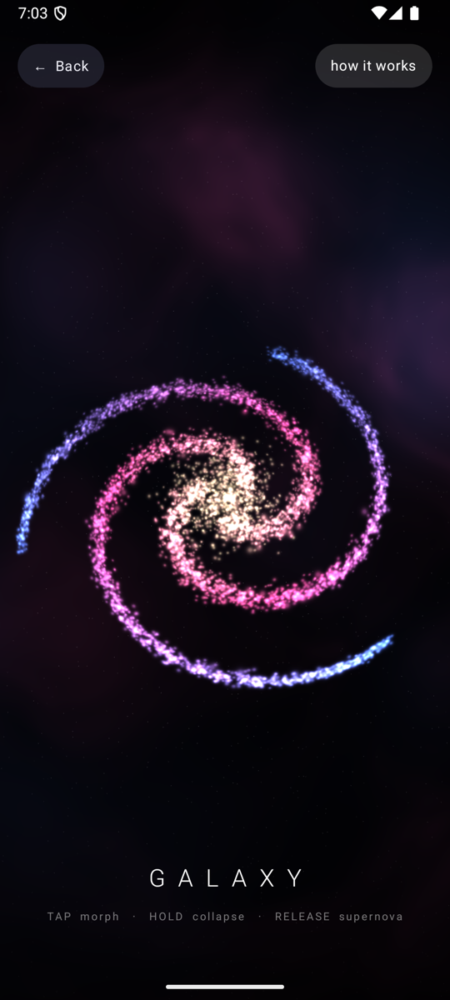
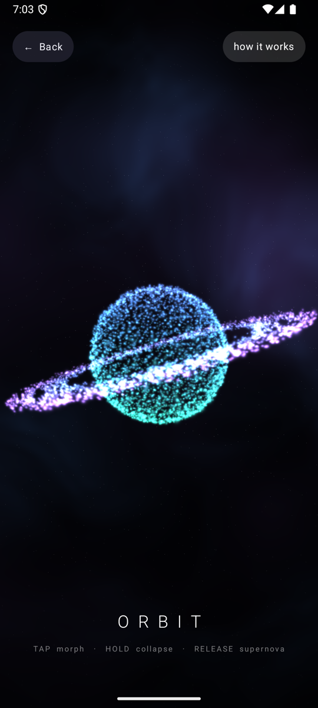
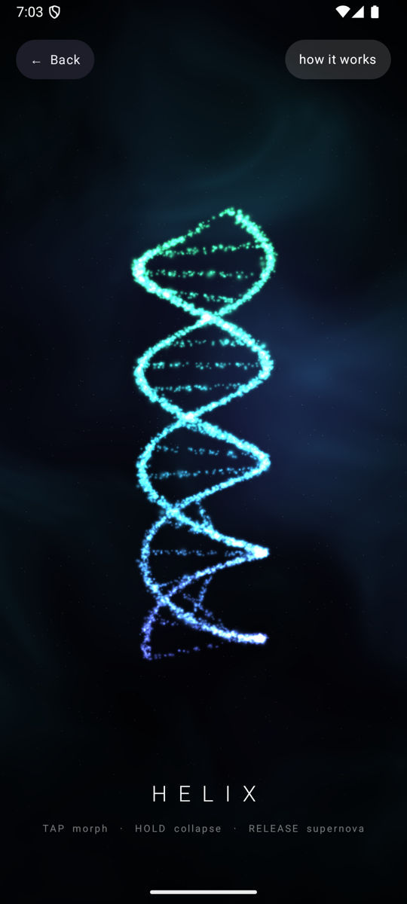
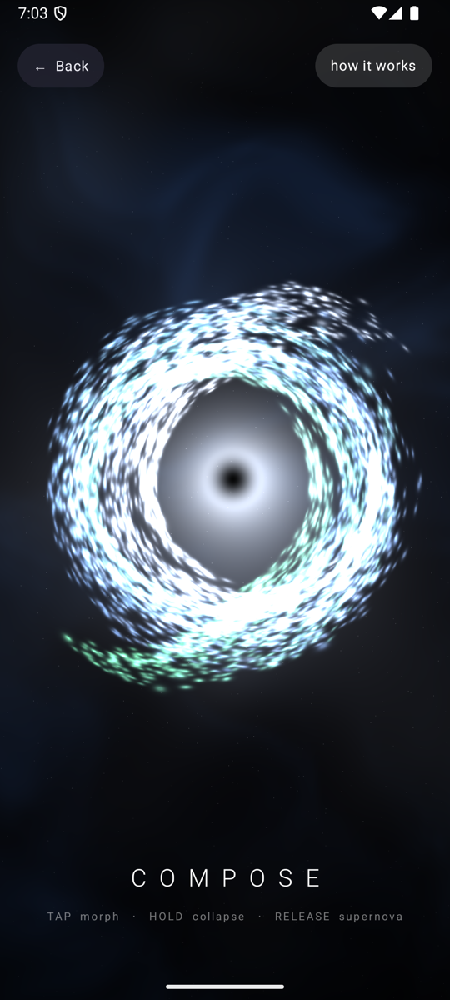
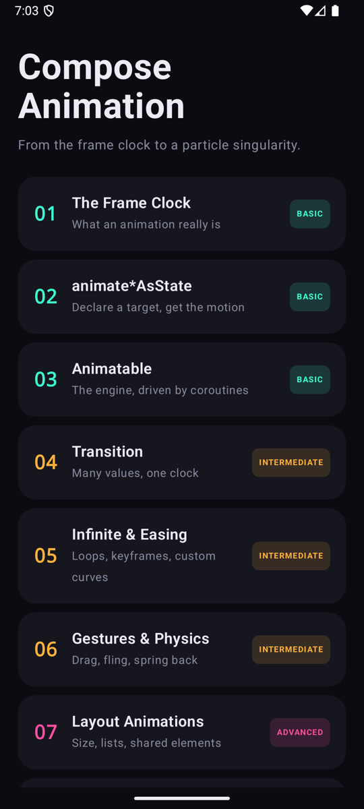
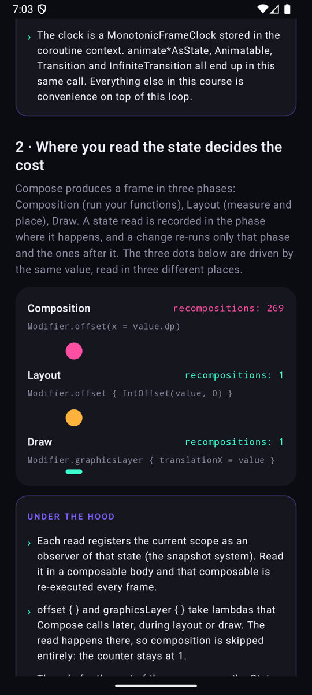
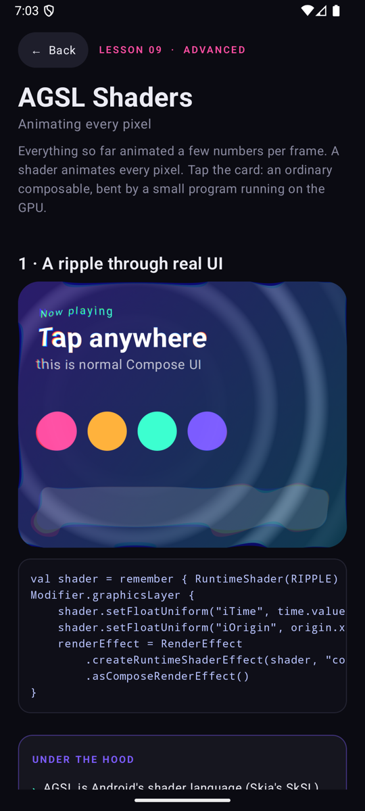
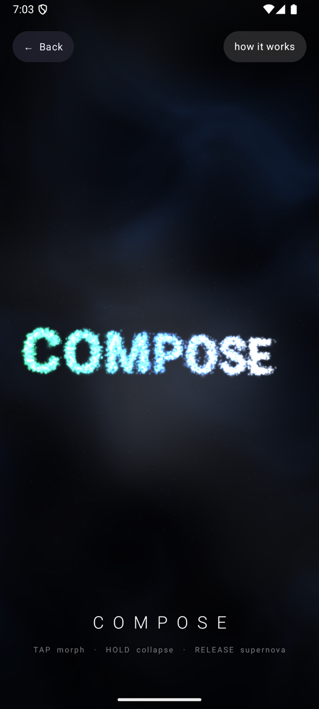

# Compose Animation: from the frame clock to a particle singularity

An Android app that teaches Jetpack Compose animation in ten lessons, from a hand-written frame loop up to a 6,000-particle 3D simulation with a GPU shader background. Every lesson is a live, interactive demo paired with an explanation of what Compose is doing internally.

<p align="center">
  
  
  
  
</p>

The capstone, **Singularity**: one swarm of particles that morphs between six shapes. Tap for a shockwave and the next shape, hold to pull everything into a black hole, release for a supernova.

## What it demonstrates

- **How Compose animation works underneath the APIs.** Lesson 1 builds an animation with nothing but `withFrameNanos`, then every later API is explained as a layer on top of that loop.
- **Performance reasoning, with measurements.** The app shows on screen how the place a state is read (composition, layout or draw) changes the work done per frame.
- **Rendering below the Compose abstraction when it matters.** The capstone draws 6,000 particles as one triangle mesh in a single draw call, with no per-frame allocation.
- **GPU shaders (AGSL).** A per-pixel ripple applied to ordinary Compose UI, and a procedural nebula driven by the same state as the particle simulation.
- **Physics-based motion.** Hand-written damped springs, velocity hand-off from gestures, and decay with bounces.

## The lessons

| # | Lesson | Level | What it covers |
|---|---|---|---|
| 1 | The Frame Clock | Basic | `withFrameNanos`, the three phases, and why the read location decides the cost |
| 2 | `animate*AsState` | Basic | Specs as pure functions of time, plotted live; type converters |
| 3 | `Animatable` | Basic | Interruption with velocity carried over; sequencing with coroutines |
| 4 | `Transition` | Intermediate | Many values on one clock; how `AnimatedVisibility` and `AnimatedContent` are built |
| 5 | Infinite & Easing | Intermediate | Repeating specs, keyframes, writing a custom `Easing` |
| 6 | Gestures & Physics | Intermediate | Swipe-to-dismiss, fling prediction with decay, bouncing off bounds |
| 7 | Layout Animations | Advanced | `animateContentSize`, `animateItem`, shared elements and the lookahead pass |
| 8 | `graphicsLayer` & Canvas | Advanced | 3D flip, `derivedStateOf`, path drawing with `PathMeasure` |
| 9 | AGSL Shaders | Advanced | `RuntimeShader` as a `RenderEffect` on live UI |
| 10 | Singularity | Capstone | Everything above, combined |

<p align="center">
  
  
  
  
</p>

The second screenshot is the experiment from lesson 1. Three dots are moved by the same animated value. The one that reads it during composition has recomposed hundreds of times; the two that read it during layout and draw have composed once.

## Engineering notes on the capstone

**Zero recompositions per frame.** The simulation lives in plain `FloatArray`s inside one object. A single `Long` state is written each frame and read only inside the `Canvas` draw lambda, so a frame costs no composition and no layout.

**Morphing without a timeline.** Each particle is its own damped spring pulled toward a target position. Changing shape only swaps the targets. A morph can therefore be interrupted at any moment by a touch or another morph and continues smoothly from the current position and velocity.

**One draw call for 6,000 particles.** The first version drew each particle as a thick round-capped line with `drawLines`. On the emulator it ran at about 22 fps, and profiling showed neither the simulation nor the GPU was the limit: the renderer was building every line as a separate shape. Replacing them with one textured triangle mesh (`Canvas.drawVertices`, per-vertex colour, additive blending) brought it to 60 fps.

| Version | Frames in 3 s | Janky frames |
|---|---|---|
| Round-capped lines, 36 `drawLines` calls | ~68 | 94% |
| One `drawVertices` mesh | 182 | 0% |

Measured with `dumpsys gfxinfo` on the Android emulator (API 36, 1080×2400, host GPU). It has not been profiled on physical devices.

**Text as particles.** The word is drawn once into a small off-screen bitmap and every lit pixel becomes a possible particle position, so any string or font works without describing letter shapes by hand.

**One world, two renderers.** The AGSL nebula receives the same touch position, shockwave radius and palette as the particle simulation, which is why the background bends and recolours together with the swarm.

**Fallbacks.** The shader needs API 33 and hardware `drawVertices` needs API 29. Below those the app falls back to a gradient background and plain dots. These paths compile but have not been run on old devices.

## Project structure

```
app/src/main/java/com/abiodun/composeanimation/
├── MainActivity.kt
├── course/
│   ├── CourseApp.kt          Home screen and navigation (one AnimatedContent, no nav library)
│   ├── Common.kt             Shared lesson scaffolding
│   └── lessons/              One file per lesson, 1 to 9
└── singularity/
    ├── Formations.kt         The six target shapes, as pure maths
    ├── ParticleSystem.kt     The simulation; contains no Compose code
    ├── NebulaBackground.kt   The AGSL shader
    └── SingularityScreen.kt  Frame loop, touch handling, drawing
```

## Tech

- Kotlin 2.2, Jetpack Compose (BOM 2026.02.01), Material 3
- No third-party libraries
- `minSdk` 24, `targetSdk` 37

## Running it

Open the project in a recent Android Studio and press Run, or from a terminal:

```
./gradlew :app:installDebug
```

An emulator or device on Android 13 or newer shows everything, including the shaders.
